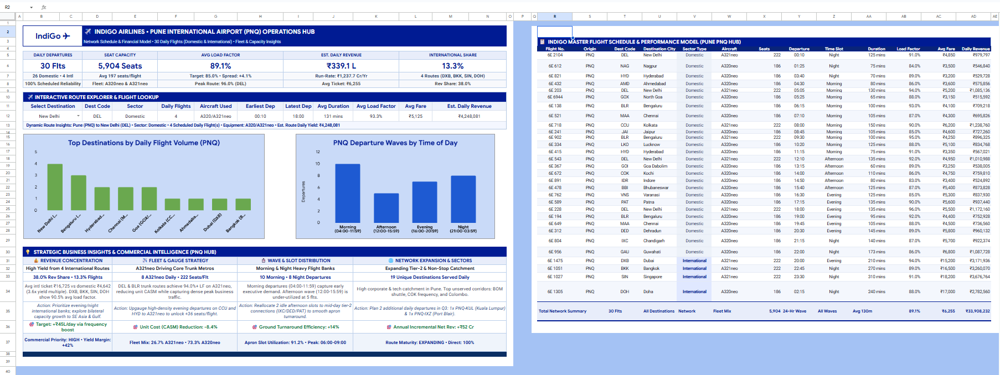
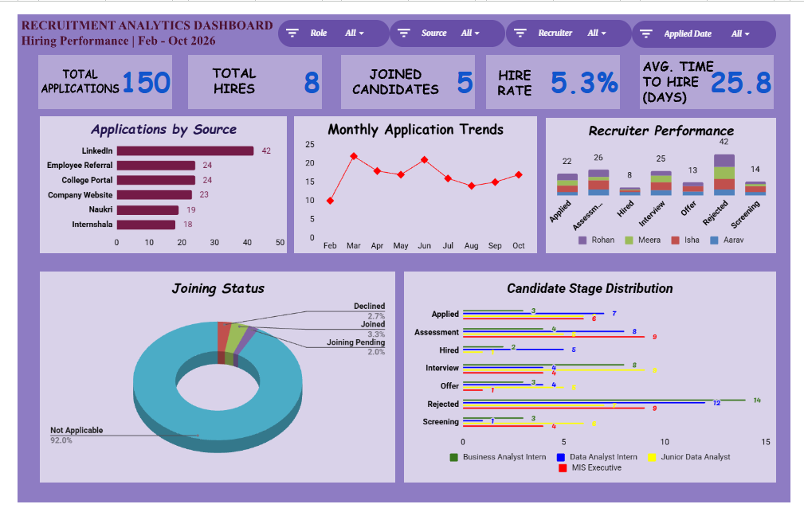

# Dashboard Suite
A collection of interactive dashboards created using Microsoft Excel to explore business data, track key performance indicators (KPIs) and communicate insights through data visualization.

This repo contains dashboards I've designed as part of my Internship at Analytics Career Connect as a Data Science &amp; Business Analyst Intern

## Excel Dashboards

### 1. E-Commerce Sales Analysis Dashboard
An Excel dashboard designed to analyze sales performance, profitability, product categories, subcategories, and regional trends.

**Key analysis areas**  
- Sales, profit, quantity, and order KPIs
- Year-over-year growth indicators
- Sales and profit trends
- Category-wise profit and sales contribution
- State-wise sales performance
- Top subcategories by sales - Interactive filters for year, region and customer segment

**Tools:** Microsoft Excel, PivotTables, PivotCharts, dashboard filters/slicers, data visualization

**Dashboard preview:** 

**WorkBook:** [Download Excel Workbook](WorkBooks/Ecommerce%20Sales%20Analysis%20Dashboard.xlsx)

### 2. Vrinda Store Annual Report Dashboard --- 2022
An Excel dashboard focused on understanding annual store sales, customer demographics, order status, sales channels, and product categories.

**Key analysis areas** 
- Orders vs sales
- Sales comparison between men and women
- Order status distribution
- Top states by sales
- Order-age and gender comparisons
- Sales contribution by order channel
- Interactive filters for channel, month and category

**Tools:** Microsoft Excel, PivotTables, PivotCharts, slicers, data visualization

**Dashboard preview:**

WorkBook: [Download Excel Workbook](WorkBooks/Vrinda%20Store%20Data%20Analysis%20DashBoard.xlsx)

### 3. Finance Bank Loan Analysis Dashboard

An interactive Excel dashboard designed to analyze bank loan applications, funded amounts, repayments, loan performance, interest rates, and borrower debt-to-income (DTI) ratios.

**Key analysis areas**
- Total loan applications and month-over-month (MoM) growth
- Total funded amount and amount received
- Average interest rate and DTI ratio
- Good loans vs. bad loans analysis
- Good and bad loan application counts and financial amounts
- Loan status analysis: Fully Paid, Charged Off, and Current
- Comparison of funded amounts, amounts received, interest rates, and DTI by loan status
- Interactive filters for loan grade and loan purpose

**Tools:** Microsoft Excel, PivotTables, PivotCharts, slicers, KPI tracking, financial data analysis, data visualization

**Dashboard preview:** 

**WorkBook:** [Download Excel Workbook](WorkBooks/Finance%20Bank%20Loan%20Analysis%20Dashboard.xlsx)

## Google Sheets Dashboards

### 1. Indigo Airlines Operations Analysis Dashboard

An interactive Google Sheets dashboard designed to analyze IndiGo Airlines' flight operations at Pune International Airport (PNQ). The dashboard provides insights into flight schedules, seat capacity, route performance, departure patterns, fleet utilization, passenger load factors, and estimated daily revenue. It combines operational reporting with strategic business insights to support airline capacity planning and network performance analysis.

**Key analysis areas**

- Daily flight departures and total seat capacity
- Average load factor and estimated daily revenue
- Domestic vs. international flight distribution
- Route-wise flight volume and destination analysis
- Interactive route explorer and flight lookup
- Departure wave analysis across morning, afternoon, evening, and night
- Flight schedule analysis by destination, aircraft, departure time, and duration
- Fleet utilization and aircraft capacity analysis
- Strategic insights on revenue concentration, fleet strategy, and network expansion

**Tools:** Google Sheets, charts, formulas, interactive dropdown filters, KPI tracking, operational data analysis, data visualization

**Dashboard preview:**

**WorkBook:** [View Google Sheets Dashboard](https://docs.google.com/spreadsheets/d/1PnqUTreRFam3paqre9dOX5eGuuALb_Z5/edit?usp=sharing)

### 2. Recruitment Analytics Dashboard

An interactive Google Sheets dashboard developed to analyze recruitment performance and hiring trends from February to October 2026. The dashboard provides insights into application sources, recruiter productivity, candidate progression, hiring outcomes, and time-to-hire metrics. It helps evaluate recruitment efficiency and identify opportunities to improve the hiring process.

**Key analysis areas**

- Total job applications, hires, and joined candidates
- Overall recruitment hire rate
- Average time to hire (days)
- Applications by recruitment source, including LinkedIn, employee referrals, college portals, and company website
- Monthly application trends
- Recruiter-wise performance analysis
- Candidate joining status distribution
- Candidate stage distribution across Applied, Assessment, Hired, Interview, Offer, Rejected, and Screening
- Role-wise recruitment analysis for Business Analyst Intern, Data Analyst Intern, Junior Data Analyst, and MIS Executive
- Interactive filters for job role, application source, recruiter, and applied date

**Tools:** Google Sheets, charts, interactive filters, KPI tracking, recruitment analytics, data visualization, business reporting

**Dashboard preview:**

**WorkBook:** [View Google Sheets Dashboard](https://docs.google.com/spreadsheets/d/1TXA7XV1du-mzfBfQNaZu-d4VOf1EpjHHWZgnkK6B-J4/edit?usp=sharing)

## Power BI Dashboards

### 1. King Koli's Cricket Analysis

👩‍💻 About Me
-

Apoorva Ayyalasomayajula
M.Tech in Data Science | Aspiring Data Analyst
Interested in data engineering, data analytics, business intelligence, Python, SQL, Excel & data visualization.
-
